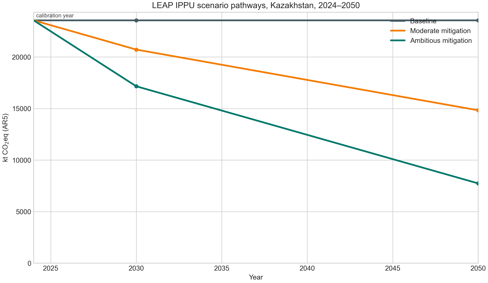
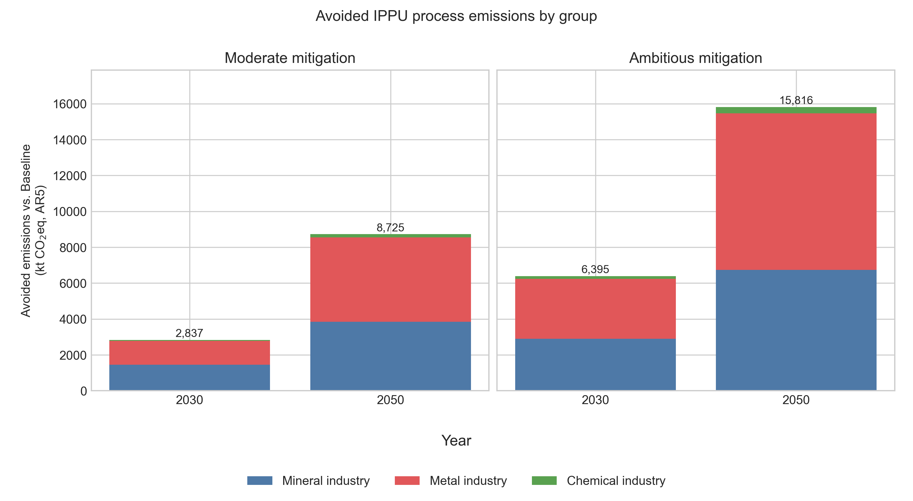

# LEAP IPPU scenarios, 2024–2050

Русская версия: [leap_scenarios_2023_2050.md](leap_scenarios_2023_2050.md).

## Purpose and status

This document records the 2024–2050 IPPU pathways of a model implemented in LEAP 2026.5.0.1 and computed using LEAP’s deterministic `Interp()` expressions (results reproduced in Python). They are **exploratory sensitivity pathways**, not forecasts, least-cost pathways or an assessment of Kazakhstan’s NDC compliance. The results apply AR5 100-year GWPs: CO2 = 1, CH4 = 28 and N2O = 265. The scenarios in the sections up to Verification use the **CRT 2025 proxy base** (23,552 kt CO2eq) and belong to the archived conference version; the journal version uses the **CRT 2026 inventory 2024 base** (22,088.3 kt CO2eq), see [Journal version](#journal-version-crt-2026-inventory-2024-base).

The LEAP implementation comprises the branch structure, the `Non Energy Effect Loading` variable, the `Interp()` expressions and the corrected [LEAP import workbook](../outputs/leap_ippu_import/Kazakhstan_IPPU_LEAP_final_import.xlsx), which is retained in the repository. The results workbook is stored locally as an immutable raw source and its provenance is recorded in the source registry. The CSV and figures are recomputed from the same expressions; the checks are listed under [Verification](#verification).

## Model boundary

The model base year is 2024. Its Current Accounts values are taken from the latest available inventory year (CRT 2025, 2023) as a proxy, assuming unchanged activity between 2023 and 2024; no separate calibration to 2024 activity data was performed. The Current Accounts boundary covers these process-emission branches:

| Group | Included processes |
|---|---|
| Mineral industry | cement, lime, glass, other carbonate uses |
| Metal industry | pig iron, steel, sinter, pellets, ferroalloys (CO2 and CH4), aluminium (CO2), zinc |
| Chemical industry | ammonia, nitric acid (N2O), calcium carbide |

F-gases, aluminium PFC emissions, lead and other non-listed IPPU sources, and industrial fuel-combustion emissions are excluded. The baseline of **23,552 kt CO2eq** is therefore a selected process-emissions boundary, not a projection of the full national IPPU inventory.

## Scenario logic

`Baseline` holds all included 2024 flows constant. Mitigation scenarios linearly interpolate from the 2024 base-year values to stated remaining-emissions factors in 2030 and 2050. They do not separately model activity growth, technology diffusion, fuel switching, costs or plant retirement.

| Scenario | Mineral: 2030 / 2050 | Metals: 2030 / 2050 | Chemicals: 2030 / 2050 |
|---|---:|---:|---:|
| Baseline | 100% / 100% | 100% / 100% | 100% / 100% |
| Moderate mitigation | 85% / 60% | 90% / 65% | 90% / 65% |
| Ambitious mitigation | 70% / 30% | 75% / 35% | 70% / 30% |

Each branch follows `Interp(2024, base, 2030, base × f2030, 2050, base × f2050)`.

### Interpretation and rationale

The factors are **author-selected analytical sensitivity assumptions**. They represent progressively deeper portfolios of recognised measures, not technology-specific abatement potentials, official Kazakhstan targets, a least-cost solution or a plant-level deployment forecast. In broad terms, mineral-process cases represent material/clinker substitution, process improvements and, in the deeper case, capture of residual calcination emissions; metal cases represent material efficiency, scrap/EAF routes where applicable, low-carbon reduction and/or capture; chemical cases represent optimisation, nitric-acid N2O abatement, route change and residual-emission control.

The evidence supports the direction and grouping of these portfolios, but not the exact numerical factors for Kazakhstan. Their full rationale, scope and source list are in [Rationale for exploratory mitigation scenarios](scenario_rationale_en.md). The results must therefore be read as the consequence of stated assumptions under a constant 2024 activity basis. About one fifth of the avoided emissions in Moderate and Ambitious (19.5–23.3% in 2030 and 2050) comes from 2.A.4.d, use of limestone and dolomite, for which no specific abatement lever is identified (see the [NID/NIR review](process_methodology_review_en.md)). Their 2030 multipliers assume more reduction than the literature found supports for lime, aluminium and ammonia (both scenarios) and for cement clinker and, marginally, iron and steel (Ambitious); the 2050 Ambitious factor for ferroalloys is deeper than the only quantified source supports (see [Literature basis for the factors](scenario_rationale_en.md#literature-basis-for-the-factors)). The presented figures are not changed.

## Results

| Scenario | 2030, kt CO2eq | 2050, kt CO2eq | Reduction vs baseline, 2030 | Reduction vs baseline, 2050 |
|---|---:|---:|---:|---:|
| Baseline | 23,552 | 23,552 | — | — |
| Moderate mitigation | 20,715 | 14,827 | 2,837 | 8,725 |
| Ambitious mitigation | 17,157 | 7,736 | 6,395 | 15,816 |



*Figure 4. LEAP IPPU process-emissions pathways, Kazakhstan, 2024–2050. Baseline is flat by construction.*



*Figure 5. Avoided emissions relative to the flat Baseline, by broad process group. Values exclude sources outside the model boundary.*

## Reproducibility

| Asset | Role |
|---|---|
| [LEAP import workbook](../outputs/leap_ippu_import/Kazakhstan_IPPU_LEAP_final_import.xlsx) | Corrected Current Accounts values and scenario expressions |
| [Scenario parameters](../data/metadata/leap_scenario_parameters.csv) | Base values, LEAP branch units and f2030/f2050 factors; the single source read by both scripts |
| [Scenario-results CSV](../data/processed/leap_ippu_scenario_results_2024_2050.csv) | Annual process, gas and scenario results |
| [Calculation script](../scripts/analyze_leap_scenarios.py) | Recreates the CSV and Figures 4–5 from the LEAP expressions |
| [Workbook-preparation script](../scripts/fill_leap_import_template.py) | Writes corrected expressions into a LEAP export template |

To recreate the analytical artefacts:

```bash
python scripts/analyze_leap_scenarios.py
```

## Verification

The following checks were performed on 18 October 2026:

| Check | Result |
|---|---|
| Expressions | All 45 scenario expressions in the import workbook (15 branches × 3 scenarios) equal `Interp(2024, base, 2030, base × f2030, 2050, base × f2050)` with the factors in the table above; the 15 Current Accounts values equal the CRT 2025 values for 2023. |
| Units | CO2 branches are entered in `Metric Tonne`. The ferroalloy CH4 and nitric-acid N2O branches are entered in `Kilogramme`, the unit fixed by the LEAP template: 36,894 kg (36.894 t) and 592,400 kg (592.4 t). `fill_leap_import_template.py` stops if a template unit differs from the parameter file. |
| AR5 conversion | With CO2 = 1, CH4 = 28 and N2O = 265, the Current Accounts total is 23,551.9 kt CO2eq. The workbook expressions give 20,714.9 and 14,826.9 kt CO2eq for Moderate and 17,156.6 and 7,735.8 kt CO2eq for Ambitious in 2030 and 2050. |
| CSV vs results workbook | Annual totals in the scenario-results CSV match the Time Series sheet of the results workbook to within 0.0005 kt CO2eq (rounding of the exported values). |
| Reproducibility | `analyze_leap_scenarios.py` reads `leap_scenario_parameters.csv` and regenerates the CSV and Figures 4–5 byte-identically to the committed files. |

## Journal version: CRT 2026 inventory 2024 base

This section was added on 18 October 2026. The journal version uses the latest inventory: the CRT 2026 submission (16 April 2026, 1990–2024). The sections above describe the presented conference scenarios, which are archived unchanged. The repository therefore uses two base levels:

| Base level | 2024, kt CO2eq (AR5) | Content | Use |
|---|---:|---|---|
| **CRT 2025 proxy base** | 23,551.9 | CRT 2025 values for 2023, used for 2024 | presented conference scenarios (archive) |
| **CRT 2026 inventory 2024 base** | 22,088.3 | CRT 2026 values for 2024 | journal version: main scenarios and sensitivity runs |

The new base is 1,463.6 kt (6.2%) lower. Two effects combine. The recalculation of 2023 in CRT 2026 lowers the boundary by 2,975.6 kt, mainly through sinter and 2.A.4.d ([recalculations](process_methodology_review_en.md#recalculations-between-crt-2025-and-crt-2026)). The change from 2023 to 2024 raises it by 1,512.0 kt (+7.3%).

| Branch, kt CO2eq | CRT 2025 proxy base | CRT 2026 inventory 2024 base | Difference |
|---|---:|---:|---:|
| Cement clinker | 4,345.7 | 4,459.9 | +114.2 |
| Lime | 721.5 | 744.2 | +22.7 |
| Glass | 24.5 | 103.5 | +79.0 |
| Other carbonate uses (2.A.4) | 4,545.0 | 3,917.5 | −627.5 |
| Pig iron | 5,041.0 | 5,614.6 | +573.6 |
| Steel | 432.6 | 531.4 | +98.8 |
| Sinter (CO2) | 3,538.9 | 1,223.7 | −2,315.2 |
| Pellets | 287.3 | 363.8 | +76.4 |
| Ferroalloys (CO2 and CH4) | 3,426.6 | 3,761.8 | +335.3 |
| Aluminium (CO2) | 403.7 | 426.5 | +22.7 |
| Zinc | 274.7 | 275.9 | +1.2 |
| Ammonia | 326.0 | 485.5 | +159.5 |
| Nitric acid (N2O) | 157.0 | 160.3 | +3.3 |
| Calcium carbide | 27.4 | 19.9 | −7.6 |
| **Total** | **23,551.9** | **22,088.3** | **−1,463.6** |

**Boundary in 2024 (CRT 2026).** The boundary covers 22,088.3 of 25,789.9 kt of IPPU emissions (85.6%). The excluded 3,701.5 kt are:

| Excluded | kt CO2eq |
|---|---:|
| 2.F F-gases | 3,098.7 |
| 2.D non-energy products from fuels and solvent use | 528.2 |
| 2.C.5 lead | 58.1 |
| CH4 from 2.C.1 (sinter; the other 2.C.1 subcategories report no CH4) | 10.6 |
| PFC from aluminium (2.C.3) | 3.1 |
| 2.G other product use | 2.7 |

**Parameters and LEAP workbook.**
- [`leap_scenario_parameters_crt2026.csv`](../data/metadata/leap_scenario_parameters_crt2026.csv) holds the CRT 2026 values for 2024 with the same branches, units and factors as before. It is built by [`build_leap_parameters.py`](../scripts/build_leap_parameters.py) `--inventory crt2026` from the CRT subcategory emissions.
- The workbook [`Kazakhstan_IPPU_LEAP_import_crt2026.xlsx`](../outputs/leap_ippu_import/Kazakhstan_IPPU_LEAP_import_crt2026.xlsx) is written by `fill_leap_import_template.py` with `--parameters` from the conference workbook. The 15 branches and all identifiers are the same; only the expressions in column L differ.
- Checks: the units match the magnitudes (34,807 kg CH4 and 604,800 kg N2O); every `Interp()` expression equals base × f; the Current Accounts total is 22,088.3 kt CO2eq. The conference workbook is unchanged.

**Main scenarios of the journal version** (presented factors, constant activity; [`leap_ippu_scenario_results_2024_2050_crt2026.csv`](../data/processed/leap_ippu_scenario_results_2024_2050_crt2026.csv)):

| Scenario | 2030, kt CO2eq | 2050, kt CO2eq | Reduction vs Baseline, 2030 | Reduction vs Baseline, 2050 |
|---|---:|---:|---:|---:|
| Baseline | 22,088 | 22,088 | — | — |
| Moderate mitigation | 19,418 | 13,896 | 2,670 | 8,192 |
| Ambitious mitigation | 16,072 | 7,236 | 6,017 | 14,852 |

The values equal the expressions of the CRT 2026 workbook. Figures: [`figure_4_leap_ippu_scenario_pathways_2024_2050_crt2026.png`](../figures/figure_4_leap_ippu_scenario_pathways_2024_2050_crt2026.png) and [`figure_5_leap_ippu_avoided_emissions_2024_2050_crt2026.png`](../figures/figure_5_leap_ippu_avoided_emissions_2024_2050_crt2026.png).

**BNS 2024 indices as a check.** The BNS 2024/2023 indices of stage 3 are no longer used for the base. Compared with the CRT 2026 activity ratios ([`bns_index_2024_check_crt2026.csv`](../data/processed/bns_index_2024_check_crt2026.csv)):

| Process | BNS index | CRT 2026 activity 2024/2023 | Difference, pp | Explanation |
|---|---:|---:|---:|---|
| Lime, pellets, ferroalloys, aluminium | 1.031, 1.261, 1.130, 1.014 | same | 0.0 | revised BNS series equal CRT |
| Pig iron | 1.156 | 1.154 | +0.2 | — |
| Cement clinker | 0.982 | 1.026 | −4.4 | CRT 2026 uses BNS clinker of 8,471.4 kt (NID 2026, p.191), a later BNS edition than the bulletin of 17 January 2025 (8,106.3 kt) |
| Ammonia | 0.826 | 0.830 | −0.5 | output agrees, but CO2 rises by 6.1% because natural gas use rose (NID 2026, p.210) |
| Sinter | 1.095 | 1.120 | −2.5 | BNS and CRT 2023 levels differ (5,070.9 vs 4,850.6 kt) |
| Steel | 1.096 | 1.079 | +1.7 | — |
| Glass | 1.009 | 1.021 | −1.2 | the CRT series includes flat glass |
| Nitric acid, zinc, calcium carbide | — | 1.021, 1.005, 0.905 | — | no BNS index |

**Observation on 2.A.4.d.** CRT 2026 reports activity data of 7,426.2 kt (2023) and 7,631.5 kt (2024), whereas NID 2026 Table 4.7 gives limestone plus dolomite of 8,653.5 and 8,857.2 kt (p.205). The emissions agree, but the CRT implied factors (0.519 and 0.499 t CO2/t) exceed the dolomite factor of 0.477, which is possible only if part of the activity data is missing in CRT. This observation requires clarification with the NID compilers. Until then, the sensitivity runs use CO2 as the activity proxy for 2.A.4.d.

## Sensitivity and activity growth

This section was revised on 18 October 2026 for the CRT 2026 inventory 2024 base; the earlier runs on the CRT 2025 proxy base were replaced. The runs are produced by [`analyze_leap_sensitivity.py`](../scripts/analyze_leap_sensitivity.py). It writes the files with the suffix `_crt2026`:
- `leap_ippu_sensitivity_2024_2050_crt2026.csv`: annual results by case, process and gas;
- `leap_ippu_sensitivity_summary_2030_2050_crt2026.csv`: totals by case;
- `leap_ippu_sensitivity_decomposition_crt2026.csv`: factors versus growth;
- `leap_ippu_sensitivity_tornado_2050_crt2026.csv`: one-at-a-time effects in 2050;
- `leap_ippu_sensitivity_growth_rates_crt2026.csv`: growth rates by process;
- `leap_ippu_2a4d_share_of_avoided_crt2026.csv`: share of 2.A.4.d in the avoided emissions of the main scenarios.

As a check, the presented factors with zero growth reproduce the main journal scenarios to within 0.001 kt.

### Method

Emissions = activity × intensity × f(t); for 2.A.4.d they are also multiplied by s, the emissive share.
- **Activity:** CRT 2026 activity data for 2024, multiplied by a growth variant after 2024.
  - For 2.A.4.a+b, whose two activity series have different units, CO2 is used as the activity proxy.
  - For 2.A.4.d, CO2 is used as the activity proxy as a forced measure, because the CRT 2026 activity data for 2023–2024 are inconsistent with the emissions (see the observation above).
- **Intensity:** CRT 2026 emissions divided by activity in 2024, held constant.
- **f(t):** the `Interp()` rule of the LEAP expressions, with AR5 GWP100.
- **Factor sets:**
  - the presented factors exactly as in the LEAP workbook, including the mineral-group factors for 2.A.4 ("-growth" cases);
  - the literature low, central and high factors, with f = 1.00 for both 2.A.4 branches; the mineral-group factors for 2.A.4.d are an alternative variant.

| Growth variant | Rule | Source |
|---|---|---|
| Zero | activity constant at the 2024 level | main scenarios |
| BNS trend to 2030 | log-linear trend of the CRT 2026 activity data for 2010–2023, applied in 2025–2030, constant afterwards; zero for glass (see below) | CRT 2026 (BNS data for most processes) |
| Official 2025–2029 | sector rates in 2025–2029, constant afterwards: manufacturing 5.8%, mining 2.9% (pellets), construction 9.3% (2.A.4.d) | MNE forecast 2025–2029, second stage, approved 27 August 2024, pp.14–15 |
| 1.5% per year to 2050 | 1.5% per year for all branches, 2025–2050 | author assumption |
| **Stress test**: half official to 2050 | half of the official sector rates (2.9%, 1.45%, 4.65%), 2025–2050 | stress test, not a projection |

- **Official forecast.** It gives growth of sector value added, not of physical output, and the sector-to-process mapping is an author assumption. This variant is therefore closer to an upper estimate.
- **Stress test.** It corresponds to about 3% per year of physical output for 26 years, which the value-added forecast does not support. It is reported separately and only shows when the main conclusion stops holding.
- **Glass.** Its trend is set to zero. Since 2022 the series includes flat glass from the single OrdaGlass plant: about three quarters of glass CO2 in 2024 (78.7 of 103.5 kt, derived from NID 2026, pp.197–198), with no history before 2022. The series without this break (container glass, 2010–2021) covers only about a quarter of the branch, which is 0.5% of the base.
- **Trend horizon.** Pure extrapolation of the trend to 2050 would multiply clinker activity 11.6-fold, so the trend is applied only to 2030.

Average annual activity growth by branch (%, from `leap_ippu_sensitivity_growth_rates_crt2026.csv`; the zero variant is 0% everywhere):

| Branch | Trend rate applied 2025–2030 | Average 2024–2050: trend | official | 1.5%/yr | stress test |
|---|---:|---:|---:|---:|---:|
| Cement clinker | 9.9% | 2.2% | 1.1% | 1.5% | 2.9% |
| Lime | 0.1% | 0.0% | 1.1% | 1.5% | 2.9% |
| Glass | 0.0% | 0.0% | 1.1% | 1.5% | 2.9% |
| 2.A.4.a+b | -3.5% | -0.8% | 1.1% | 1.5% | 2.9% |
| 2.A.4.d | 4.1% | 0.9% | 1.7% | 1.5% | 4.7% |
| Pig iron | 0.4% | 0.1% | 1.1% | 1.5% | 2.9% |
| Steel | -0.6% | -0.1% | 1.1% | 1.5% | 2.9% |
| Sinter | -0.3% | -0.1% | 1.1% | 1.5% | 2.9% |
| Pellets | -3.1% | -0.7% | 0.6% | 1.5% | 1.4% |
| Ferroalloys (CO2 and CH4) | 2.3% | 0.5% | 1.1% | 1.5% | 2.9% |
| Aluminium | 1.0% | 0.2% | 1.1% | 1.5% | 2.9% |
| Zinc | -0.4% | -0.1% | 1.1% | 1.5% | 2.9% |
| Ammonia | 7.8% | 1.8% | 1.1% | 1.5% | 2.9% |
| Nitric acid | 6.0% | 1.3% | 1.1% | 1.5% | 2.9% |
| Calcium carbide | -0.3% | -0.1% | 1.1% | 1.5% | 2.9% |

### Results

| kt CO2eq (AR5), 2030 | Zero | Trend to 2030 | Official 2025–2029 | 1.5%/yr to 2050 | Stress test: half official to 2050 |
|---|---:|---:|---:|---:|---:|
| Baseline-growth | 22,088 | 27,455 | 30,112 | 24,152 | 26,668 |
| Moderate-growth | 19,418 | 24,027 | 26,444 | 21,233 | 23,429 |
| Ambitious-growth | 16,072 | 19,858 | 21,884 | 17,574 | 19,390 |
| Literature-low | 17,864 | 22,389 | 24,525 | 19,533 | 21,661 |
| Literature-central | 21,036 | 26,158 | 28,717 | 23,002 | 25,419 |
| Literature-high | 22,088 | 27,455 | 30,112 | 24,152 | 26,668 |

| kt CO2eq (AR5), 2050 | Zero | Trend to 2030 | Official 2025–2029 | 1.5%/yr to 2050 | Stress test: half official to 2050 |
|---|---:|---:|---:|---:|---:|
| Baseline-growth | 22,088 | 27,455 | 30,112 | 32,530 | 50,622 |
| Moderate-growth | 13,896 | 17,163 | 18,916 | 20,465 | 31,714 |
| Ambitious-growth | 7,236 | 8,876 | 9,839 | 10,657 | 16,457 |
| Literature-low | 7,169 | 8,684 | 10,390 | 10,558 | 19,460 |
| Literature-central | 14,009 | 17,988 | 19,440 | 20,631 | 33,779 |
| Literature-high | 20,063 | 24,913 | 27,438 | 29,547 | 46,403 |

With zero growth, the "-growth" cases equal the main journal scenarios.


*Figure 6. Included IPPU process emissions with activity growth, CRT 2026 inventory 2024 base, Kazakhstan, 2024–2050, kt CO2eq (AR5 GWP100). (a) Presented factors; (b) literature-based factors. Lines: the BNS 2010–2023 trend applied to 2030; bands: range across zero growth, the trend, the official forecast and 1.5% per year to 2050 (the stress test is not shown); grey dots: main journal scenarios with zero growth. Sources: CRT 2026, MNE forecast 2025–2029, literature factors (stage 2), author calculations. Selected process-emissions boundary only.*


*Figure 7. Effect of one assumption at a time on included IPPU process emissions in 2050, kt CO2eq (AR5 GWP100). Reference: CRT 2026 inventory 2024 base, literature central factors, BNS trend to 2030, 2.A.4.d with f = 1.00 and s = 1.00 (17,988 kt). The stress test is shown as a separate bar. Sources as for Figure 6.*

### Factors versus growth

The 2050 result has the following ranges (kt CO2eq). Growth ranges are computed with the central literature factors, factor ranges with the trend.

| Growth assumptions compared | Range from growth | Range from factors | Factors / growth |
|---|---:|---:|---:|
| Growth stops by 2030 (zero, trend, official) | 5,431 (14,009–19,440) | 16,230 (8,684–24,913) | 3.0 |
| Plausible variants (plus 1.5% per year to 2050) | 6,622 (14,009–20,631) | 16,230 (8,684–24,913) | 2.5 |
| Stress test (plus half the official rates to 2050) | 19,770 (14,009–33,779) | 16,230 (8,684–24,913) | 0.8 |

**Conclusion.** Under the plausible growth variants, the factors matter about two and a half to three times more than activity growth in 2050:
- the factors span 16,230 kt;
- growth spans 5,431 kt if it stops by 2030, and 6,622 kt with 1.5% per year to 2050.

The conclusion stops holding only in the stress test. If physical output grew at half the official sector rates (about 3% per year) for 26 years, growth would span 19,770 kt and outweigh the factors.

In 2030 growth matters more than the factors: 7,681 kt against 5,066 kt.

Within the factors:
- cement clinker has the largest single-process effect (6,208 kt), ahead of iron and steel (5,596 kt), because sinter is much smaller in CRT 2026;
- applying the Ambitious mineral-group factors to 2.A.4.d lowers the reference by 3,397 kt;
- the lower bound s = 0.80 lowers it by 971 kt.

Limitations: the growth mapping, the trend horizon and the 1.5% variant are author assumptions, and the official rates refer to value added. The CRT 2026 base is reported data for 2024, so no proxy or index is involved.

## Article-safe wording

Use: “Under exploratory LEAP scenarios with a 2024 base year (2023 inventory proxy), included IPPU branches decline to 20,715–17,157 kt CO2eq in 2030 and 14,827–7,736 kt CO2eq in 2050, relative to a flat 23,552 kt CO2eq baseline.”

Do not claim that Kazakhstan’s entire IPPU sector will emit 7,736 kt CO2eq in 2050, or infer costs, technology-specific feasibility, or compliance with national targets.

## Model and metric references

- Model: Heaps, C. G. (2022). *LEAP: The Low Emissions Analysis Platform* [Software version: 2026.5.0.1]. Stockholm Environment Institute, Somerville, MA, USA. [https://leap.sei.org](https://leap.sei.org). Format as recommended on the [LEAP citation page](https://leap.sei.org/default.asp?action=citing); the page shows the current version, 2026.7.0.3, and the version used here is given instead.
- GWP100 values: Myhre, G., Shindell, D., Bréon, F.-M., et al. (2013). Anthropogenic and Natural Radiative Forcing. In: *Climate Change 2013: The Physical Science Basis. Contribution of Working Group I to the Fifth Assessment Report of the IPCC*, pp. 659–740. Cambridge University Press. [https://doi.org/10.1017/CBO9781107415324.018](https://doi.org/10.1017/CBO9781107415324.018). Table 8.7, p. 714: CH4 = 28 and N2O = 265 without climate–carbon feedbacks.
- Reporting rule: UNFCCC (2019). Decision 18/CMA.1, FCCC/PA/CMA/2018/3/Add.2, pp. 18–52; annex, para. 37 (p. 25): Parties use the 100-year GWP values from the IPCC Fifth Assessment Report. [PDF](https://unfccc.int/sites/default/files/resource/CMA2018_03a02E.pdf).

BibTeX keys: `heaps2022leap`, `myhre2013anthropogenic`, `unfccc2019decision18cma1` in [references.bib](references.bib).
