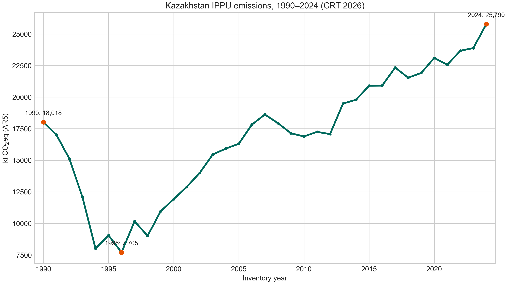
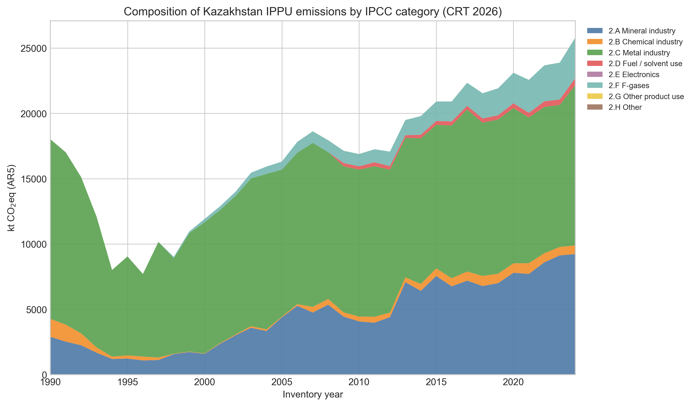
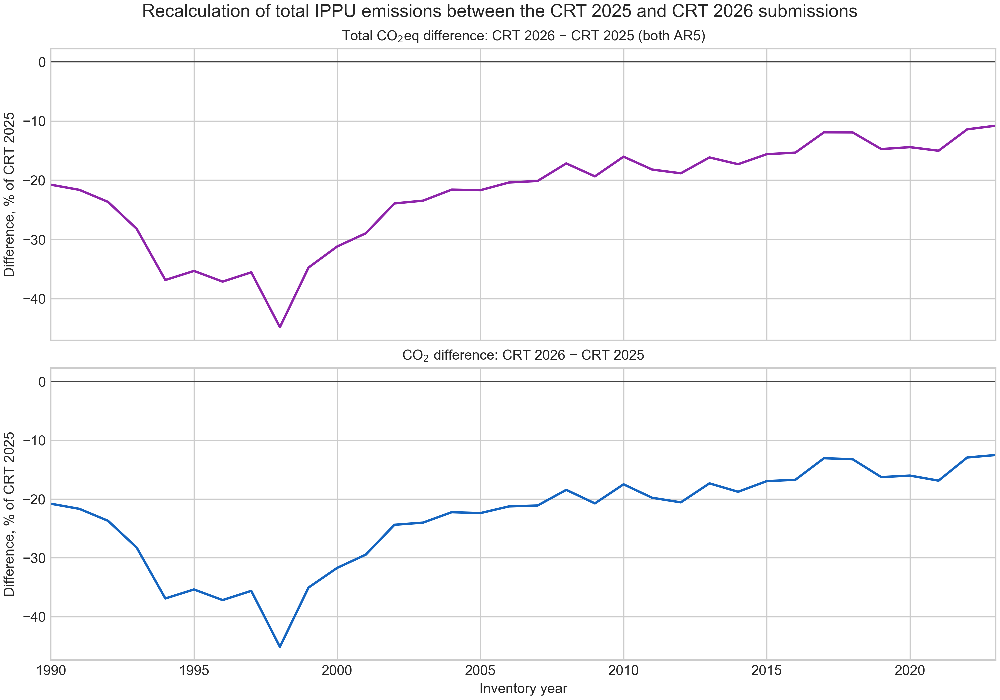
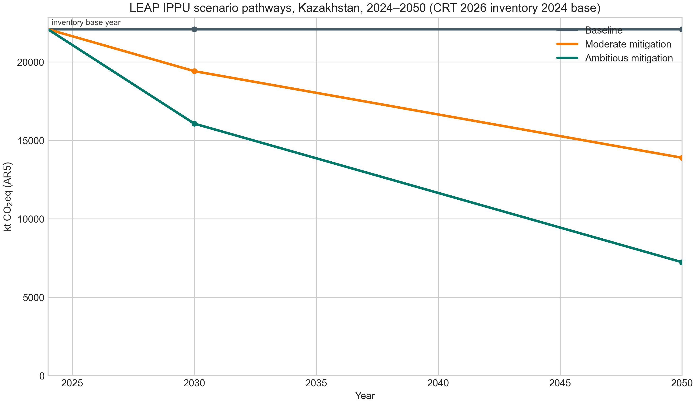
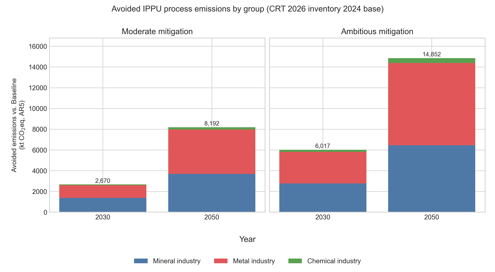
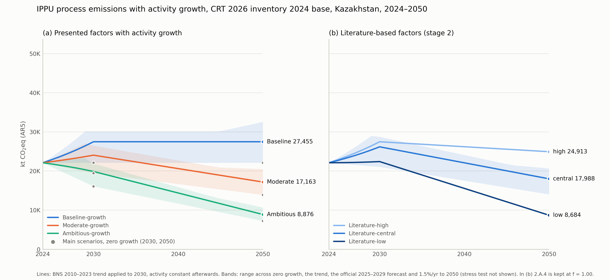
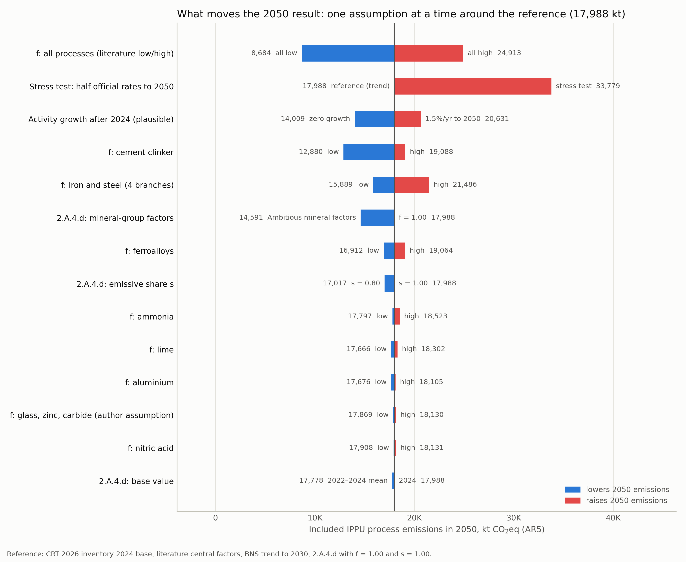

# Процессные выбросы промышленности Казахстана: согласование кадастровых данных и исследовательские сценарии LEAP до 2050 г.

English version: [manuscript_full_en.md](manuscript_full_en.md).

> **Статус (19 октября 2026 г.).** Журнальная версия на кадастре CRT 2026 (1990–2024 гг.). Разделы 1–5 написаны. Все числа взяты из файлов `_crt2026` в `data/processed/`, каждая ссылка в тексте есть в [references.bib](references.bib). Архивная конференционная версия (CRT 2025) — в [manuscript_historical_results_discussion.md](manuscript_historical_results_discussion.md); она не изменялась.

## Аннотация

Процессные выбросы промышленности нельзя устранить только декарбонизацией энергоснабжения, однако сценарные исследования для Казахстана редко описывают их на уровне процессов. Исследование объединяет представление кадастра парниковых газов Казахстана 2026 г. (CRT 2026, 1990–2024 гг.) и исследовательскую модель LEAP из 15 ветвей процессных выбросов, которые охватывают 85.6% выбросов сектора «Промышленные процессы и использование продукции» (IPPU) в 2024 г. По данным CRT 2026, выбросы IPPU снизились с 18 018 тыс. т CO2-экв. в 1990 г. до 7 705 тыс. т CO2-экв. в 1996 г. и выросли до 25 790 тыс. т CO2-экв. в 2024 г. Пересчёты относительно предыдущего представления снизили ряд во все годы, в 1990 г. — на 20.8%, главным образом за счёт агломерата. В 2021 г. данные о деятельности кадастра точно совпадают с национальной статистикой производства для клинкера, извести, нерафинированной стали и ферросплавов, а видимые расхождения по чугуну и цинку отражают границы предприятий и технологических потоков. От базы 2024 г. в 22 088 тыс. т CO2-экв. сценарии Moderate и Ambitious снижают включённые выбросы до 19 418 и 16 072 тыс. т CO2-экв. в 2030 г. и до 13 896 и 7 236 тыс. т CO2-экв. в 2050 г. Множители по литературе подтверждают уровень Moderate в 2050 г. (14 009 тыс. т CO2-экв.), но предполагают более медленное сокращение до 2030 г. Около пятой части предотвращённых выбросов приходится на использование известняка и доломита (2.A.4.d) — расчётный остаток кадастра без установленного конечного использования. При правдоподобном росте активности множители остаточных выбросов в 2050 г. примерно в 2.5–3 раза важнее роста; изменить это может только устойчивый рост физического выпуска примерно на 3% в год. Траектории — исследовательские результаты для заданной границы процессов, а не прогноз и не оценка выполнения национальных целей.

**Ключевые слова:** Казахстан; промышленные процессы и использование продукции; кадастр парниковых газов; LEAP; сценарии декарбонизации; анализ чувствительности

## 1. Введение

Промышленные процессы и использование продукции (IPPU) — отдельная часть национальных кадастров парниковых газов: их выбросы возникают при химических и физических превращениях материалов, например при кальцинации карбонатов в производстве клинкера или использовании углерода как восстановителя в металлургии, а не при сжигании топлива. Поэтому их нельзя устранить только декарбонизацией энергоснабжения. По этой причине исследования цемента и стали рассматривают процессные выбросы, замещение материалов, новые маршруты восстановления и улавливание углерода (Obrist et al., 2021; Tautorat et al., 2023; Müller et al., 2024), а оценка МГЭИК рассматривает промышленность как сектор с собственными вариантами сокращения (Bashmakov et al., 2022).

В Казахстане выбросы IPPU в 2024 г. достигли 25 789.9 тыс. т CO2-экв., что на 43.1% выше уровня 1990 г., по данным представления кадастра 2026 г. (Republic of Kazakhstan, 2026a). Обновлённый ОНУВ устанавливает сокращение по всей экономике на 15% (безусловное) и 25% (условное) к 2030 г. относительно 1990 г. (Government of the Republic of Kazakhstan, 2023, p. 4), а Стратегия достижения углеродной нейтральности до 2060 г. утверждена в 2023 г. (President of the Republic of Kazakhstan, 2023).

Большинство количественных траекторий для Казахстана — исследования энергосистемы. Zhakiyev et al. (2023) с помощью модели TIMES сравнивают базовый сценарий и сценарий углеродной нейтральности до 2060 г.; De Miglio and Bakdolotov (2024) исследуют развитие энергетики при заданном пользователем критерии риска; Cassetti et al. (2023) строят сценарии, включая траекторию нулевых нетто-выбросов, для четырёх стран Центральноазиатско-Каспийского региона; Zhakiyev, Kayisli, et al. (2025) прогнозируют выбросы энергетики и промышленности в сценариях с высокой долей возобновляемых источников. Обзоры рассматривают энергопереход региона, политику и зависимость от ископаемого топлива (Radovanović et al., 2021; Zhakiyev, Khamzina, et al., 2025). Работы о промышленности Казахстана рассматривают хабы улавливания углерода (Khoyashov et al., 2024), систему торговли выбросами (Khussain et al., 2025) и декарбонизацию горнодобывающей и металлургической отраслей (Aubakirova et al., 2023; Menzies et al., 2024; Holtz et al., 2025).

Для восходящего моделирования промышленности LEAP (Heaps, 2022) применяли к технологическим траекториям цемента и стали: например, модель G-LEAP для цементной промышленности Китая (Tan et al., 2022), совмещение LEAP и LCA (Dang et al., 2026) и симуляции производства чугуна и стали на основе LEAP, включая водородную металлургию (Duan et al., 2022; Wan & Li, 2024). Эти работы показывают пользу явного представления процессов, но их параметры относятся к другим промышленным системам.

Khamzina et al. (2026) — ближайший предшественник: сценарии IPPU для Казахстана до 2040 г. (без мер, с текущими мерами и с дополнительными мерами), построенные по трендам категорий национального кадастра, с мерой по материалоэффективности цемента, обоснованной молекулярным моделированием. Настоящее исследование дополняет эту работу в четырёх отношениях. Во-первых, оно использует последнее представление кадастра (CRT 2026, 1990–2024 гг.) и показывает, что пересчёты между представлениями меняют уровень 1990 г. примерно на пятую часть. Во-вторых, оно работает на уровне процессов — с данными о деятельности и интенсивностью для 15 ветвей — и проверяет их сопоставимость с национальной статистикой. В-третьих, оно применяет множители сокращения ко всем основным ветвям минеральной, металлургической и химической промышленности, распространяя меры за пределы цемента, и проверяет их по опубликованным траекториям. В-четвёртых, оно разделяет рост активности и интенсивность процессов и показывает, что из них определяет результат 2050 г. Результаты двух работ напрямую не сопоставимы: Khamzina et al. (2026) охватывают все выбросы IPPU, включая F-газы, до 2040 г., а настоящее исследование — 85.6% выбросов IPPU 2024 г. без F-газов до 2050 г.

Статья отвечает на четыре вопроса: (1) как изменились выбросы IPPU Казахстана и их структура в 1990–2024 гг.; (2) как пересчёты CRT 2026 меняют исторический ряд и базу модели; (3) в какой мере видимые различия между национальной статистикой и данными о деятельности кадастра объясняются границами продуктов и процессов; (4) как включённые процессные выбросы меняются к 2030 и 2050 гг. при исследовательских множителях сокращения, множителях по литературе и разных вариантах роста активности. В разделе 2 описаны данные и методы, в разделе 3 приведены результаты, в разделе 4 они обсуждаются, раздел 5 содержит выводы.

## 2. Данные и методы

### 2.1. Кадастровые данные

Исследование опирается на представление кадастра парниковых газов Казахстана в РКИК ООН 2026 г.: таблицы общей отчётности (CRT 2026; Republic of Kazakhstan, 2026a) за 1990–2024 гг. и Национальный документ об инвентаризации (NID 2026; Republic of Kazakhstan, 2026b). Суммарные выбросы IPPU по категориям взяты из таблицы CRT 2(I), выбросы и данные о деятельности по подкатегориям — из таблиц 2(I).A–H. Предыдущее представление (CRT 2025, 1990–2023 гг.; Republic of Kazakhstan, 2025a) используется только для оценки пересчётов. Методическая основа для включённых категорий — Руководящие принципы МГЭИК 2006 г. (IPCC, 2006) и Уточнение 2019 г. (IPCC, 2019).

Все агрегированные значения даны в тыс. т CO2-экв. с потенциалами глобального потепления за 100 лет (GWP100) из Пятого оценочного доклада МГЭИК: CO2 = 1, CH4 = 28 и N2O = 265 (Myhre et al., 2013, табл. 8.7, с. 714). Эти значения Стороны используют для отчётности в рамках расширенной системы прозрачности (UNFCCC, 2019, решение 18/CMA.1, приложение, п. 37). CRT 2025 и CRT 2026 используют GWP AR5, поэтому различия между ними — пересчёты, а не эффект метрики.

### 2.2. Данные о деятельности и национальная статистика

Данные о деятельности кадастра сопоставлены со статистикой физического выпуска Бюро национальной статистики (BNS, 2022–2026). Числовое расхождение считается расхождением данных только после того, как подтверждено совпадение продукта, единицы, территории, технологического потока и границы «предприятие или вся страна». Методы по процессам взяты из NID 2025 (Republic of Kazakhstan, 2025b). Год сравнения — 2021: для семи сравниваемых процессов данные о деятельности за 2021 г. в CRT 2026 совпадают с CRT 2025.

### 2.3. Граница модели

Сценарная модель охватывает 15 ветвей процессных выбросов минеральной, металлургической и химической промышленности (табл. 1). В 2024 г. на эти ветви приходится 22 088.3 из 25 789.9 тыс. т CO2-экв. суммарных выбросов IPPU (85.6%). Исключённые 3 701.5 тыс. т CO2-экв. — это F-газы (2.F), неэнергетические продукты из топлива и использование растворителей (2.D), свинец (2.C.5), CH4 от агломерата, ПФУ от алюминия и прочее использование продукции (2.G). Сжигание топлива в промышленности относится к сектору «Энергетика» кадастра и в границу не входит.

**Таблица 1. Граница модели в 2024 г., тыс. т CO2-экв. (GWP100 AR5).**

| Ветвь | Код МГЭИК | Газ | 2024 | Доля границы |
|---|---|---|---:|---:|
| Чугун | 2.C.1.b | CO2 | 5 614.6 | 25.4% |
| Цементный клинкер | 2.A.1 | CO2 | 4 459.9 | 20.2% |
| Прочие виды использования карбонатов | 2.A.4 | CO2 | 3 917.5 | 17.7% |
| Ферросплавы | 2.C.2 | CO2 | 3 760.9 | 17.0% |
| Ферросплавы | 2.C.2 | CH4 | 1.0 | 0.0% |
| Агломерат | 2.C.1.d | CO2 | 1 223.7 | 5.5% |
| Известь | 2.A.2 | CO2 | 744.2 | 3.4% |
| Сталь | 2.C.1.a | CO2 | 531.4 | 2.4% |
| Аммиак | 2.B.1 | CO2 | 485.5 | 2.2% |
| Алюминий | 2.C.3 | CO2 | 426.5 | 1.9% |
| Окатыши | 2.C.1.e | CO2 | 363.8 | 1.6% |
| Цинк | 2.C.6 | CO2 | 275.9 | 1.2% |
| Азотная кислота | 2.B.2 | N2O | 160.3 | 0.7% |
| Стекло | 2.A.3 | CO2 | 103.5 | 0.5% |
| Карбид кальция | 2.B.5 | CO2 | 19.9 | 0.1% |
| **Включено, всего** | | | **22 088.3** | **100%** |
| *Исключено:* F-газы | 2.F | ГФУ, ПФУ | 3 098.7 | |
| *Исключено:* неэнергетические продукты из топлива и растворители | 2.D | CO2 | 528.2 | |
| *Исключено:* свинец | 2.C.5 | CO2 | 58.1 | |
| *Исключено:* CH4 от агломерата | 2.C.1.d | CH4 | 10.6 | |
| *Исключено:* ПФУ от алюминия | 2.C.3 | ПФУ | 3.1 | |
| *Исключено:* прочее использование продукции | 2.G | разные | 2.7 | |
| *Исключено, всего* | | | *3 701.5* | |

Источник: CRT 2026, таблицы 2(I) и 2(I).A–H (Republic of Kazakhstan, 2026a); расчёты авторов. Из-за округления исключённые составляющие не дают итог в точности.

### 2.4. Базовый год и уровни базы

Базовый год модели — 2024; текущие счета (Current Accounts) равны значениям CRT 2026 за 2024 г. Для архивной конференционной версии в репозитории сохранён второй уровень базы: значения CRT 2025 за 2023 г. как приближение для 2024 г. (табл. 2). Все результаты статьи относятся к базе CRT 2026 inventory 2024.

**Таблица 2. Уровни базы модели, тыс. т CO2-экв. (GWP100 AR5).**

| Уровень базы | Значение 2024 г. | Содержание | Применение |
|---|---:|---|---|
| CRT 2025 proxy base | 23 551.9 | значения CRT 2025 за 2023 г., принятые для 2024 г. | архивная конференционная версия |
| CRT 2026 inventory 2024 base | 22 088.3 | значения CRT 2026 за 2024 г. | настоящая статья |

Источник: CRT 2025 и CRT 2026, таблицы 2(I).A–H (Republic of Kazakhstan, 2025a, 2026a); расчёты авторов.

База CRT 2026 ниже на 1 463.6 тыс. т (6.2%). Складываются два эффекта: пересчёт 2023 г. в CRT 2026 снижает границу на 2 975.6 тыс. т, с 23 551.9 до 20 576.3 тыс. т, а изменение с 2023 к 2024 г. повышает её на 1 512.0 тыс. т (7.3%).

### 2.5. Реализация в LEAP

Модель реализована в LEAP 2026.5.0.1 (Heaps, 2022). Каждая из 15 ветвей представлена переменной `Non Energy Effect Loading`; её значение в Current Accounts — выброс ветви в 2024 г. в тоннах газа. Ветви CO2 заданы в метрических тоннах; ветвь CH4 ферросплавов и ветвь N2O азотной кислоты заданы в килограммах — единице шаблона LEAP (34 807 кг CH4 и 604 800 кг N2O). Сценарные значения задаются выражением

`Interp(2024, base, 2030, base × f2030, 2050, base × f2050)`,

где f2030 и f2050 — множители остаточных выбросов. Результаты рассчитаны по детерминированным выражениям `Interp()` LEAP и воспроизведены в Python; параметры, книга импорта LEAP и скрипты перечислены в разделе «Доступность данных».

### 2.6. Сценарии

В Baseline каждая ветвь остаётся на уровне 2024 г. Сценарии Moderate и Ambitious mitigation линейно интерполируют к множителям табл. 3. Множитель 0.85, например, означает выбросы на 15% ниже значения ветви 2024 г. при неизменной активности. Множители — заданные авторами огибающие для наборов известных мер: замещение клинкера и материалов и, в более глубоком варианте, улавливание CO2 кальцинации для минеральных процессов; материалоэффективность, маршруты на основе лома, низкоуглеродное восстановление и улавливание для металлургии; оптимизация процессов, сокращение N2O при производстве азотной кислоты, смена маршрута и улавливание для химии. Это не потенциалы отдельных технологий, не официальные цели и не решение минимальной стоимости.

**Таблица 3. Множители остаточных выбросов основных сценариев (доля значения ветви 2024 г.).**

| Группа процессов | Moderate: 2030 / 2050 | Ambitious: 2030 / 2050 |
|---|---:|---:|
| Минеральная промышленность (2.A.1–2.A.4) | 0.85 / 0.60 | 0.70 / 0.30 |
| Металлургия (2.C.1, 2.C.2, 2.C.3, 2.C.6) | 0.90 / 0.65 | 0.75 / 0.35 |
| Химическая промышленность (2.B.1, 2.B.2, 2.B.5) | 0.90 / 0.65 | 0.70 / 0.30 |

Источник: сценарный дизайн авторов; параметры — `data/metadata/leap_scenario_parameters_crt2026.csv`. Множитель Baseline равен 1.00 во все годы.

### 2.7. Прочие виды использования карбонатов (2.A.4)

Категория 2.A.4 — третья по величине ветвь границы (табл. 1), и почти вся она приходится на подкатегорию 2.A.4.d «Использование известняка и доломита» (табл. 4). Кадастр оценивает 2.A.4.d как продажи известняка и доломита на внутреннем рынке за вычетом их использования в металлургии, производстве карбида кальция и клинкера; конечное использование остатка не установлено (NID 2025, с. 167–170). В CRT 2026 к вычитаемым объёмам добавлено использование в производстве стекла (NID 2026, с. 203–207), а производство извести (2.A.2) по-прежнему среди них отсутствует (NID 2026, табл. 4.6, с. 204).

**Таблица 4. Состав категории 2.A.4 в 2024 г.**

| Подкатегория | Данные о деятельности, тыс. т | Подразумеваемый коэффициент, т CO2/т | CO2, тыс. т | Доля 2.A.4 |
|---|---:|---:|---:|---:|
| 2.A.4.a Керамика | 689.1 | 0.0484 | 33.4 | 0.9% |
| 2.A.4.b Прочее использование кальцинированной соды | 176.6 | 0.4150 | 73.3 | 1.9% |
| 2.A.4.c Неметаллургическая магнезия | NO | NO | NO | — |
| 2.A.4.d Использование известняка и доломита | 7 631.5 | 0.4994 | 3 810.9 | 97.3% |
| **2.A.4, всего** | | | **3 917.5** | **100%** |

Источник: CRT 2026, таблица 2(I).A–H (Republic of Kazakhstan, 2026a); расчёты авторов. NO — не происходит.

Для сценариев важны три свойства 2.A.4.d. Во-первых, к неустановленным потребителям нельзя привязать определённый рычаг сокращения. Во-вторых, остаток может пересекаться с производством извести; верхняя граница пересечения — выброс 2.A.2, 744.2 тыс. т, или 19.5% 2.A.4.d в 2024 г. (оценка авторов). В-третьих, данные о деятельности 2.A.4.d в CRT 2026 (7 426.2 тыс. т в 2023 г. и 7 631.5 тыс. т в 2024 г.) ниже итогов по известняку и доломиту в NID 2026 (8 653.5 и 8 857.2 тыс. т; табл. 4.7, с. 205), тогда как выбросы совпадают. Получающиеся подразумеваемые коэффициенты, 0.519 и 0.499 т CO2/т, выше коэффициента доломита 0.477 т CO2/т, что возможно, только если часть данных о деятельности в CRT отсутствует. Это наблюдение требует уточнения у составителей кадастра.

В основных сценариях 2.A.4 остаётся в минеральной группе с множителями табл. 3, как в книге LEAP. В наборах множителей по литературе (раздел 2.8) обе ветви 2.A.4 имеют f = 1.00, а эмиссионная доля 2.A.4.d равна s = 1.00. Анализ чувствительности добавляет для 2.A.4.d три варианта: нижнюю границу s = 0.80, которая снимает всё возможное пересечение с известью; множители минеральной группы основных сценариев; среднее за 2022–2024 гг. (3 645.8 тыс. т) вместо значения 2024 г. в качестве базы.

### 2.8. Множители по литературе

Чтобы проверить множители табл. 3, для каждого процесса по опубликованным траекториям выведены нижнее, центральное и верхнее значения f2030 и f2050 (табл. 5). Множитель умножает выбросы при неизменной активности, поэтому значения из литературы переведены в множители интенсивности: f равен отношению целевой интенсивности к базовой, единице минус доля производства с близкими к нулю выбросами или единице минус процент сокращения. Значения, включающие снижение спроса, не использовались, потому что активность варьируется отдельно (раздел 2.9). Нижнее значение — самое глубокое сокращение интенсивности, которое подтверждает литература; центральное — опорный сценарий, если он есть, иначе середина между нижним и верхним; верхнее — наименее амбициозное свидетельство или задокументированное ограничение Казахстана. Вывод о том, что CCS в металлургии Казахстана не ожидается в ближайшие 10–15 лет (Holtz et al., 2025, p. 37), используется как ограничение для всех рычагов, зависящих от CCS, только в 2030 г.

В 2030 г. центральное значение опирается на опорный сценарий для 6 процессов (57.1% базы), на середину диапазона для 5 процессов (23.3%) и на допущение авторов для 5 процессов (19.5%). В 2050 г. соответствующие значения — 8 процессов (60.1%), 3 процесса (20.4%) и 5 процессов (19.5%).

**Таблица 5. Множители остаточных выбросов по литературе (нижний / центральный / верхний).**

| Процесс | f2030 | f2050 | Основание центрального значения | Основные источники |
|---|---|---|---|---|
| Цементный клинкер (2.A.1) | 0.84 / 0.97 / 1.00 | 0.06 / 0.71 / 0.85 | опорный сценарий | IEA (2023, p. 96); IEA and Cement Sustainability Initiative (2018, Table 2); верхний: допущение авторов (доля клинкера по данным БНС, сроки CCS по Holtz et al., 2025, p. 37) |
| Известь (2.A.2) | 0.90 / 0.95 / 1.00 | 0.10 / 0.53 / 0.95 | середина диапазона | European Lime Association (2023, pp. 18–19) |
| Стекло (2.A.3) | 0.70 / 0.85 / 1.00 | 0.30 / 0.60 / 1.00 | допущение авторов | не найдено |
| 2.A.4.a+b и 2.A.4.d | 1.00 / 1.00 / 1.00 | 1.00 / 1.00 / 1.00 | допущение авторов | не найдено |
| Чугун, сталь, агломерат, окатыши (2.C.1) | 0.79 / 1.00 / 1.00 | 0.11 / 0.38 / 0.83 | опорный сценарий | IEA (2020, pp. 43, 73, 97); Menzies et al. (2024, pp. 17, 49) |
| Ферросплавы (2.C.2) | 0.60 / 0.80 / 1.00 | 0.50 / 0.75 / 1.00 | середина диапазона | Jayakumari et al. (2026, p. 2); Holtz et al. (2025, p. 35) |
| Алюминий (2.C.3) | 0.93 / 1.00 / 1.00 | 0.04 / 0.73 / 0.99 | опорный сценарий | IEA (2023, p. 95); Menzies et al. (2024, pp. 17, 49) |
| Цинк (2.C.6) | 0.75 / 0.90 / 1.00 | 0.35 / 0.65 / 1.00 | допущение авторов | не найдено |
| Аммиак (2.B.1) | 0.97 / 0.99 / 1.00 | 0.05 / 0.30 / 1.00 | середина (2030); опорный сценарий (2050) | IEA (2021, p. 10); Holtz et al. (2025, p. 41) |
| Азотная кислота (2.B.2) | 0.02 / 0.51 / 1.00 | 0.02 / 0.37 / 1.00 | середина (2030); опорный сценарий (2050) | European Commission (2007, Table 3.14, p. 140); NID 2025 (с. 175) |
| Карбид кальция (2.B.5) | 0.70 / 0.90 / 1.00 | 0.30 / 0.65 / 1.00 | допущение авторов | не найдено |

Источник: `data/metadata/leap_sensitivity_factors.csv` и `data/metadata/scenario_levers_literature.csv` (записи L01–L36 со страницей или таблицей для каждого значения). Где литература не найдена, нижнее значение равно множителю Ambitious, центральное — Moderate, верхнее — 1.00.

По сравнению с этими диапазонами множители табл. 3 на 2030 г. предполагают большее сокращение, чем подтверждает литература, для извести, алюминия и аммиака в обоих сценариях, а также для цементного клинкера и, незначительно, чугуна и стали в Ambitious. В 2050 г., кроме 2.A.4, вне диапазона лежит только множитель Ambitious для ферросплавов (0.35).

### 2.9. Рост активности и анализ чувствительности

В расчётах чувствительности выбросы каждой ветви равны активность × интенсивность × f(t), для 2.A.4.d — дополнительно × s. Активность — данные о деятельности CRT 2026 за 2024 г., умноженные на индекс роста; интенсивность — отношение выбросов к активности в 2024 г., постоянное во времени; f(t) следует правилу `Interp()` раздела 2.5. Для 2.A.4.a+b, два ряда данных о деятельности которой имеют разные единицы, показателем активности служит CO2. Для 2.A.4.d показателем активности также служит CO2 — вынужденная мера, потому что данные о деятельности CRT 2026 не согласуются с выбросами (раздел 2.7). При нулевом росте и множителях табл. 3 метод воспроизводит основные сценарии с точностью до 0.001 тыс. т.

Используются пять вариантов роста (табл. 6). Четыре из них считаются правдоподобными, пятый — стресс-тест. Официальный прогноз Министерства национальной экономики описывает рост добавленной стоимости отраслей, а не физического выпуска, и соотнесение отраслей с процессами — допущение авторов, поэтому этот вариант ближе к верхней оценке. Стресс-тест соответствует примерно 3% в год физического выпуска на протяжении 26 лет, что прогноз добавленной стоимости не подтверждает; он лишь показывает условие, при котором основной вывод перестаёт работать. Тренд стекла принят нулевым: с 2022 г. ряд включает листовое стекло одного нового завода, на которое приходится около трёх четвертей CO2 стекла в 2024 г. (78.7 из 103.5 тыс. т, рассчитано по NID 2026, с. 197–198), поэтому лог-линейный тренд отражает ввод завода, а не рост. Тренд применяется только до 2030 г., потому что его экстраполяция до 2050 г. увеличила бы активность клинкера в 11.6 раза.

**Таблица 6. Варианты роста активности после 2024 г.**

| Вариант | Правило | Источник |
|---|---|---|
| Нулевой | активность постоянна на уровне 2024 г. | основные сценарии |
| Тренд до 2030 г. | лог-линейный тренд данных о деятельности CRT 2026 за 2010–2023 гг., применяется в 2025–2030 гг., затем постоянный уровень; для стекла нулевой | CRT 2026 (Republic of Kazakhstan, 2026a) |
| Официальный 2025–2029 | отраслевые темпы в 2025–2029 гг., затем постоянный уровень: обрабатывающая промышленность 5.8%, горнодобывающая 2.9% (окатыши), строительство 9.3% (2.A.4.d) в год | Ministry of National Economy of the Republic of Kazakhstan (2024, с. 14–15) |
| 1.5% в год до 2050 г. | 1.5% в год для всех ветвей в 2025–2050 гг. | допущение авторов |
| Стресс-тест | половина официальных отраслевых темпов (2.9%, 1.45% и 4.65% в год) в 2025–2050 гг. | стресс-тест, не прогноз |

Средние годовые темпы роста по ветвям для каждого варианта — в `data/processed/leap_ippu_sensitivity_growth_rates_crt2026.csv`.

С каждым вариантом роста сочетаются шесть наборов множителей: множители трёх основных сценариев («Baseline-growth», «Moderate-growth» и «Ambitious-growth») и нижние, центральные и верхние множители по литературе. Опорный вариант для анализа «по одному допущению» сочетает центральные множители по литературе, тренд до 2030 г., f = 1.00 и s = 1.00 для 2.A.4.d и значение 2024 г. в качестве базы. Чтобы сравнить два источника неопределённости, диапазон выбросов 2050 г. по вариантам роста (при центральных множителях) сопоставляется с диапазоном по наборам множителей (при тренде).

## 3. Результаты

### 3.1. Исторический тренд

По данным CRT 2026, суммарные выбросы IPPU Казахстана снизились с 18 018.3 тыс. т CO2-экв. в 1990 г. до минимума 7 705.1 тыс. т CO2-экв. в 1996 г., то есть на 57.2% (рис. 1). Затем они выросли до 23 882.3 тыс. т CO2-экв. в 2023 г. и 25 789.9 тыс. т CO2-экв. в 2024 г. — максимума ряда. Уровень 2024 г. на 234.7% выше минимума 1996 г., на 43.1% выше 1990 г. и на 8.0% выше 2023 г. Ряд — официальная траектория кадастра, а не прямой показатель физического выпуска: изменения отражают выпуск, технологии, структуру продукции, источники данных и методы кадастра.

*Рисунок 1. Суммарные выбросы IPPU Казахстана, 1990–2024 гг., тыс. т CO2-экв. (GWP100 AR5). Источник: CRT 2026, таблица 2(I) (Republic of Kazakhstan, 2026a); расчёты авторов.*

### 3.2. Структура по категориям

Металлургия (2.C) осталась крупнейшей категорией, но её доля снизилась с 76.3% в 1990 г. до 47.6% в 2024 г., когда её выбросы составили 12 269.5 тыс. т CO2-экв. (рис. 2). Доля минеральной промышленности (2.A) выросла с 16.1% до 35.8% (9 225.0 тыс. т CO2-экв. в 2024 г.). F-газы (2.F), отсутствовавшие в 1990 г. и превышающие 1% итога с 1998 г., достигли 12.0% в 2024 г. (3 098.7 тыс. т CO2-экв.). Доля химической промышленности (2.B) снизилась с 7.6% до 2.6% (665.7 тыс. т CO2-экв.), на неэнергетические продукты из топлива и растворители (2.D) пришлось 2.0% (528.2 тыс. т CO2-экв.). Поэтому модели выбросов IPPU Казахстана нужны отдельные ветви минеральной промышленности, металлургии и F-газов.

*Рисунок 2. Структура выбросов IPPU Казахстана по категориям МГЭИК, 1990–2024 гг., тыс. т CO2-экв. (GWP100 AR5). Источник: CRT 2026, таблица 2(I) (Republic of Kazakhstan, 2026a); расчёты авторов.*

### 3.3. Пересчёты между CRT 2025 и CRT 2026

CRT 2026 даёт более низкие суммарные выбросы IPPU, чем CRT 2025, во все годы 1990–2023 гг. (рис. 3): на 4 723.0 тыс. т CO2-экв. (20.8%) в 1990 г., на 7 325.0 тыс. т CO2-экв. (44.8%) в 1998 г. — наибольшее относительное различие — и на 2 890.4 тыс. т CO2-экв. (10.8%) в 2023 г. Оба представления используют GWP AR5, поэтому различия — пересчёты. В 2023 г. изменение сосредоточено в металлургии (−2 609.2 тыс. т CO2-экв.) и минеральной промышленности (−512.3 тыс. т CO2-экв.) и частично компенсируется химической промышленностью (+131.6 тыс. т CO2-экв.) и F-газами (+99.5 тыс. т CO2-экв.). Пересчёт агломерата даёт 94.1% различия в 1990 г., 96.3% в 1996 г. и 85.2% в 2023 г. В табл. 7 приведены основные пересчёты по подкатегориям и их причины по NID 2026.

*Рисунок 3. Пересчёт суммарных выбросов IPPU между представлениями CRT 2025 и CRT 2026, 1990–2023 гг., % от CRT 2025. Верхняя панель: суммарные CO2-экв. (GWP100 AR5 в обоих представлениях); нижняя панель: CO2. Источник: CRT 2025 и CRT 2026, таблица 2(I) (Republic of Kazakhstan, 2025a, 2026a); расчёты авторов.*

**Таблица 7. Основные пересчёты по подкатегориям, CRT 2025 → CRT 2026, тыс. т CO2-экв. (GWP100 AR5).**

| Подкатегория | 2023 | 1990 | Причина (NID 2026) |
|---|---|---|---|
| 2.C.1.d Агломерат | 3 548.4 → 1 085.7 (−2 462.7) | 6 916.7 → 2 473.7 (−4 443.0) | весь ряд пересчитан по рекомендациям рассмотрения, чтобы избежать двойного учёта: коксовый и доменный газ пересчитаны с плотностью и теплотворной способностью; добавлен известняк для агломерации (с. 226–230) |
| 2.C.1.b Чугун | 5 041.0 → 4 901.0 (−140.0) | 7 919.1 → 7 653.7 (−265.4) | CO2 известняка перенесён из чугуна в агломерат (с. 221; с. 229) |
| 2.A.4.d Использование известняка и доломита | 4 400.0 → 3 855.5 (−544.5) | 341.5 → 341.5 | известняк и доломит для производства стекла добавлены к вычитаемым видам использования (с. 203–207) |
| 2.B.1 Аммиак | 326.0 → 457.6 (+131.6) | 995.5 → 1 095.7 (+100.2) | весь природный газ аммиачного завода отнесён к IPPU и исключён из 1.A.2.c (с. 209–210) |
| 2.A.3 Стекло | 24.5 → 97.8 (+73.4) | 0 → 0 | добавлено листовое стекло завода, работающего с октября 2022 г. (с. 197–199) |
| 2.A.4.a Керамика | 73.5 → 32.4 (−41.2) | 7.1 → 3.1 (−4.0) | применён коэффициент 0.44 т CO2/т карбоната, ряд пересчитан (с. 200) |

Источник: CRT 2025 и CRT 2026, таблицы 2(I).A–H (Republic of Kazakhstan, 2025a, 2026a); NID 2026 (Republic of Kazakhstan, 2026b); расчёты авторов.

Пересчёты меняют историческую картину. Для одних и тех же лет рост от минимума 1996 г. до 2023 г. составляет 118.4% в CRT 2025 и 210.0% в CRT 2026, потому что пересчёт снижает 1996 г. на 37.1%, а 2023 г. — на 10.8%. В границе модели значение 2023 г. снижается с 23 551.9 до 20 576.3 тыс. т CO2-экв. (−12.6%).

### 3.4. Сопоставимость данных о деятельности по процессам

Совпадение данных БНС и кадастра зависит от того, одинаковы ли определение продукта и граница двух показателей (табл. 8). Клинкер, известь, нерафинированная сталь и суммарный выпуск ферросплавов в 2021 г. совпадают точно. Два крупных видимых расхождения сравнивают разные совокупности. По цинку БНС даёт весь необработанный цинк, а кадастр — цинк из вельц-окиси, полученный в вельц-печах одного завода (NID 2025, с. 200). По чугуну кадастр использует данные интегрированного предприятия с коксом, известняком и углеродным балансом (NID 2025, с. 179–184), поэтому расхождение 11.8% не является установленным несоответствием. По первичному алюминию опубликованный длинный ряд БНС объединяет алюминий и оксид алюминия, поэтому корректное сравнение невозможно (NID 2025, с. 194–195).

**Таблица 8. Сопоставимость данных о деятельности БНС и кадастра, 2021 г., млн т.**

| Процесс | БНС | CRT 2026 | Статус | Интерпретация |
|---|---:|---:|---|---|
| Клинкер, 2.A.1 | 7.295700 | 7.295700 | прямая | тот же национальный выпуск клинкера (NID 2025, с. 157); портландцемент (12.312700 млн т) его не заменяет |
| Известь, 2.A.2 | 0.933623 | 0.933623 | прямая на агрегатном уровне | тот же агрегат БНС; кадастр делит его 85/15 между высококальциевой и доломитовой известью (NID 2025, с. 160) |
| Чугун, 2.C.1.b | 3.623764 | 3.195305 | не прямая | национальный выпуск против входных данных интегрированного предприятия |
| Нерафинированная сталь, 2.C.1.a | 4.526071 | 4.526071 | прямая как показатель выпуска | для выбросов нужны также параметры углеродного баланса |
| Ферросплавы, 2.C.2 | 2.070038 | 2.070038 | прямая как суммарный выпуск | по-прежнему нужны структура сплавов и данные о восстановителях (NID 2025, с. 190–191) |
| Первичный алюминий, 2.C.3 | — | — | корректное сравнение невозможно | длинный ряд БНС объединяет алюминий и глинозём |
| Цинк, 2.C.6 | 0.300886 | 0.081861 | не прямая | национальный итог против потока вельц-печей |

Источник: статистика физического выпуска БНС за 2021 г. (BNS, 2022–2026); CRT 2026, таблица 2(I).A–H (Republic of Kazakhstan, 2026a); NID 2025 (Republic of Kazakhstan, 2025b); расчёты авторов. Значения 2021 г. в CRT 2026 совпадают с CRT 2025.

Для 2024 г. уточнённые ряды БНС дают то же изменение к предыдущему году, что и CRT 2026, для извести, окатышей, ферросплавов и алюминия. По клинкеру индекс бюллетеня БНС ниже на 4.4 п.п., потому что CRT 2026 использует более позднюю редакцию БНС — 8 471.4 тыс. т (NID 2026, с. 191) вместо 8 106.3 тыс. т, опубликованных в бюллетене января 2025 г.

### 3.5. Основные сценарии

При неизменной активности включённые выбросы снижаются с 22 088 тыс. т CO2-экв. в 2024 г. до 19 418 тыс. т CO2-экв. в 2030 г. и 13 896 тыс. т CO2-экв. в 2050 г. в сценарии Moderate mitigation и до 16 072 и 7 236 тыс. т CO2-экв. в сценарии Ambitious mitigation (табл. 9, рис. 4).

**Таблица 9. Основные сценарии, тыс. т CO2-экв. (GWP100 AR5).**

| Сценарий | 2030 | 2050 | Сокращение к Baseline, 2030 | Сокращение к Baseline, 2050 |
|---|---:|---:|---:|---:|
| Baseline | 22 088 | 22 088 | — | — |
| Moderate mitigation | 19 418 | 13 896 | 2 670 (12.1%) | 8 192 (37.1%) |
| Ambitious mitigation | 16 072 | 7 236 | 6 017 (27.2%) | 14 852 (67.2%) |

Источник: расчёты авторов по выражениям LEAP; `data/processed/leap_ippu_scenario_results_2024_2050_crt2026.csv`. Только выбранная граница процессных выбросов (табл. 1).

*Рисунок 4. Включённые процессные выбросы IPPU в основных сценариях, Казахстан, 2024–2050 гг., тыс. т CO2-экв. (GWP100 AR5). Baseline постоянен по построению. Источник: база CRT 2026 inventory 2024; расчёты авторов по выражениям LEAP.*

По группам наибольшее предотвращение выбросов в 2050 г. в обоих сценариях даёт металлургия: 4 269.2 из 8 192.2 тыс. т CO2-экв. в Moderate и 7 928.5 из 14 852.0 тыс. т CO2-экв. в Ambitious (рис. 5). В Moderate в 2030 г. минеральная промышленность даёт немного больше (1 383.8 тыс. т CO2-экв.), чем металлургия (1 219.8 тыс. т CO2-экв.), потому что её множитель на 2030 г. ниже. Эти доли следуют из базовых значений и множителей и не означают, что какая-либо технология более осуществима.

Около пятой части предотвращённых выбросов приходится на 2.A.4.d, для которой рычаг сокращения не определён: 21.4% (2030) и 18.6% (2050) в Moderate и 19.0% и 18.0% в Ambitious.

*Рисунок 5. Предотвращённые выбросы относительно Baseline по группам процессов в 2030 и 2050 гг., тыс. т CO2-экв. (GWP100 AR5). Источник: база CRT 2026 inventory 2024; расчёты авторов по выражениям LEAP. Источники вне границы модели не учтены.*

### 3.6. Множители по литературе и рост активности

При неизменной активности центральные множители по литературе дают 21 036 тыс. т CO2-экв. в 2030 г. и 14 009 тыс. т CO2-экв. в 2050 г. (табл. 10). В 2050 г. это близко к Moderate (13 896 тыс. т CO2-экв.); в 2030 г. — выше Moderate (19 418 тыс. т CO2-экв.), то есть представленные множители предполагают более раннее сокращение, чем подтверждает литература. Нижние множители по литературе дают 7 169 тыс. т CO2-экв. в 2050 г., близко к Ambitious (7 236 тыс. т CO2-экв.).

**Таблица 10. Включённые выбросы по наборам множителей и вариантам роста, тыс. т CO2-экв. (GWP100 AR5).**

| Вариант, 2030 | Нулевой | Тренд до 2030 г. | Официальный 2025–2029 | 1.5% в год | Стресс-тест |
|---|---:|---:|---:|---:|---:|
| Baseline-growth | 22 088 | 27 455 | 30 112 | 24 152 | 26 668 |
| Moderate-growth | 19 418 | 24 027 | 26 444 | 21 233 | 23 429 |
| Ambitious-growth | 16 072 | 19 858 | 21 884 | 17 574 | 19 390 |
| Литература, нижние | 17 864 | 22 389 | 24 525 | 19 533 | 21 661 |
| Литература, центральные | 21 036 | 26 158 | 28 717 | 23 002 | 25 419 |
| Литература, верхние | 22 088 | 27 455 | 30 112 | 24 152 | 26 668 |

| Вариант, 2050 | Нулевой | Тренд до 2030 г. | Официальный 2025–2029 | 1.5% в год | Стресс-тест |
|---|---:|---:|---:|---:|---:|
| Baseline-growth | 22 088 | 27 455 | 30 112 | 32 530 | 50 622 |
| Moderate-growth | 13 896 | 17 163 | 18 916 | 20 465 | 31 714 |
| Ambitious-growth | 7 236 | 8 876 | 9 839 | 10 657 | 16 457 |
| Литература, нижние | 7 169 | 8 684 | 10 390 | 10 558 | 19 460 |
| Литература, центральные | 14 009 | 17 988 | 19 440 | 20 631 | 33 779 |
| Литература, верхние | 20 063 | 24 913 | 27 438 | 29 547 | 46 403 |

Источник: `data/processed/leap_ippu_sensitivity_summary_2030_2050_crt2026.csv`; расчёты авторов. Варианты «-growth» используют множители основных сценариев; при нулевом росте они совпадают с табл. 9.

*Рисунок 6. Включённые процессные выбросы IPPU с учётом роста активности, Казахстан, 2024–2050 гг., тыс. т CO2-экв. (GWP100 AR5). (a) Множители основных сценариев; (b) множители по литературе. Линии: тренд до 2030 г.; полосы: диапазон по четырём правдоподобным вариантам роста (стресс-тест не показан); серые точки: основные сценарии при нулевом росте. Источник: база CRT 2026 inventory 2024 (Republic of Kazakhstan, 2026a); Ministry of National Economy of the Republic of Kazakhstan (2024); множители по литературе (табл. 5); расчёты авторов.*

В 2050 г. множители важнее роста активности при всех правдоподобных вариантах роста (табл. 11). По наборам множителей выбросы 2050 г. различаются на 16 230 тыс. т CO2-экв. По вариантам роста — на 5 431 тыс. т CO2-экв., если рост прекращается к 2030 г., и на 6 622 тыс. т CO2-экв., если активность растёт на 1.5% в год до 2050 г.; таким образом, множители важнее роста примерно в 2.5–3 раза. Вывод перестаёт работать только в стресс-тесте, где рост даёт диапазон 19 770 тыс. т CO2-экв. В 2030 г. рост важнее множителей: 7 681 против 5 066 тыс. т CO2-экв.

**Таблица 11. Диапазоны выбросов 2050 г. от роста и от множителей, тыс. т CO2-экв. (GWP100 AR5).**

| Сравниваемые варианты роста | Диапазон от роста (центральные множители) | Диапазон от множителей (тренд) | Множители / рост |
|---|---:|---:|---:|
| Рост прекращается к 2030 г. (нулевой, тренд, официальный) | 5 431 (14 009–19 440) | 16 230 (8 684–24 913) | 3.0 |
| Правдоподобные (плюс 1.5% в год до 2050 г.) | 6 622 (14 009–20 631) | 16 230 (8 684–24 913) | 2.5 |
| Стресс-тест (плюс половина официальных темпов до 2050 г.) | 19 770 (14 009–33 779) | 16 230 (8 684–24 913) | 0.8 |

Источник: `data/processed/leap_ippu_sensitivity_decomposition_crt2026.csv`; расчёты авторов.

Среди отдельных допущений (рис. 7) наибольшее влияние на опорный вариант 2050 г. (17 988 тыс. т CO2-экв.) оказывают множители всех процессов вместе (16 230 тыс. т CO2-экв.), затем стресс-тест (15 791 тыс. т CO2-экв.) и правдоподобный рост (6 622 тыс. т CO2-экв.). Среди отдельных процессов наибольшее влияние у множителя цементного клинкера (6 208 тыс. т CO2-экв.), затем чугуна и стали (5 596 тыс. т CO2-экв.). Применение множителей минеральной группы Ambitious к 2.A.4.d снижает опорный вариант на 3 397 тыс. т CO2-экв., нижняя граница s = 0.80 — на 971 тыс. т CO2-экв.

*Рисунок 7. Влияние каждого допущения по отдельности на включённые процессные выбросы IPPU в 2050 г., тыс. т CO2-экв. (GWP100 AR5). Опорный вариант: центральные множители по литературе, тренд до 2030 г., 2.A.4.d с f = 1.00 и s = 1.00 (17 988 тыс. т CO2-экв.). Стресс-тест показан отдельной полосой. Источник: как для рис. 6; `data/processed/leap_ippu_sensitivity_tornado_2050_crt2026.csv`.*

## 4. Обсуждение

### 4.1. Сначала границы процессов, потом проценты

Процентное расхождение между данными БНС и кадастра само по себе не является мерой качества данных. Категория IPPU может описывать химическое превращение, маршрут интегрированного предприятия или узкий технологический поток, а не товарную продукцию национальной статистики. Случаи клинкера и цинка показывают две формы одной проблемы: замена клинкера портландцементом создаёт большое искусственное расхождение при точном совпадении правильного показателя, а сравнение национального выпуска цинка с одним потоком вельц-печей создаёт большое расхождение между совокупностями, которые и не должны совпадать. Обоснованная процедура сначала устанавливает продукт, охват, границу предприятия, маршрут и единицу; только оставшееся расхождение между эквивалентными показателями можно исследовать как несоответствие.

### 4.2. Пересчёты кадастра и базовый год

Пересчёты между CRT 2025 и CRT 2026 настолько велики, что меняют и базу, и историческую картину. Уровень 1990 г. ниже на 20.8%, рост с 1996 по 2023 г. составляет 210.0% вместо 118.4%, а значение границы модели в 2023 г. ниже на 12.6%, главным образом потому, что агломерат пересчитан для устранения двойного учёта. Поэтому сценарное исследование, откалиброванное по одному представлению, нельзя напрямую сравнивать с исследованием, откалиброванным по другому. По этой причине статья использует последнее представление и приводит оба уровня базы (табл. 2); база CRT 2026 к тому же не требует приближения по 2023 г., потому что содержит отчётные данные за 2024 г.

### 4.3. Категория 2.A.4.d как неопределённость кадастра

Около пятой части предотвращённых выбросов в основных сценариях приходится на 2.A.4.d — остаток внутренних продаж известняка и доломита без установленного конечного использования. Применение к нему множителей цементного типа предполагает рычаги, например замещение клинкера или улавливание на печах, которые нельзя привязать к неустановленным потребителям. Остаток может также пересекаться с производством извести (до 19.5% 2.A.4.d в 2024 г.) и включать использование в качестве заполнителя или щебня, которое Руководящие принципы МГЭИК относят к неэмиссионному (IPCC, 2006, Vol. 3, p. 2.36 и Table 2.7). Данные о деятельности CRT 2026, из которых следует коэффициент выше, чем у доломита, добавляют ещё одно несоответствие. В анализе чувствительности выбор между f = 1.00 и множителями минеральной группы для 2.A.4.d сдвигает опорный вариант 2050 г. на 3 397 тыс. т CO2-экв. — больше, чем диапазоны множителей ферросплавов, аммиака или извести. Поэтому 2.A.4.d следует сначала рассматривать как вопрос кадастра, а уже потом как возможность сокращения. В минеральной промышленности на цементный клинкер (2.A.1) в 2024 г. пришлось 48.3% выбросов 2.A, на 2.A.4.d — 41.3% (CRT 2026). Поэтому меры только для цемента охватывают меньше половины процессных выбросов минеральной промышленности.

### 4.4. Амбициозность множителей относительно литературы

Представленные множители Moderate согласуются с центральными значениями по литературе в 2050 г. (13 896 против 14 009 тыс. т CO2-экв. при неизменной активности), но в 2030 г. предполагают более раннее сокращение, чем подтверждает литература (19 418 против 21 036 тыс. т CO2-экв.). Разрыв возникает для рычагов, зависящих от CCS, инертных анодов или новых маршрутов восстановления, которые в Казахстане до 2030 г. не ожидаются; в металлургии CCS не ожидается в ближайшие 10–15 лет (Holtz et al., 2025, p. 37). Сценарий Ambitious в 2050 г. (7 236 тыс. т CO2-экв.) близок к результату нижних множителей по литературе (7 169 тыс. т CO2-экв.), то есть к самым глубоким сокращениям интенсивности, найденным для всех процессов одновременно. Для аммиака Khoyashov et al. (2024) называют производство аммиака и переработку природного газа самыми дешёвыми вариантами улавливания CO2 в Казахстане, что поддерживает отношение к аммиаку как к раннему кандидату на улавливание, однако у единственного аммиачного завода нет запланированной инфраструктуры хранения CO2 (Holtz et al., 2025, p. 41).

### 4.5. Множители против роста активности

При правдоподобных допущениях о росте результат 2050 г. зависит от множителей остаточных выбросов примерно в 2.5–3 раза сильнее, чем от роста активности. Это поддерживает сосредоточение сценариев на интенсивности процессов. У вывода два ограничения. Во-первых, он меняется на обратный в стресс-тесте, где физический выпуск растёт примерно на 3% в год в течение 26 лет; такой рост не подтверждается официальным прогнозом добавленной стоимости, но показывает, что устойчивое расширение промышленности может перевесить снижение интенсивности. Во-вторых, в 2030 г. рост важнее множителей, потому что множители до 2030 г. меняются мало, а тренд и официальный прогноз сосредоточивают рост в 2025–2030 гг.

### 4.6. Политический контекст

Сценарии не оценивают выполнение национальных целей. Обновлённый ОНУВ Казахстана устанавливает сокращение выбросов по всей экономике на 15% (безусловное) и 25% (условное) к 2030 г. относительно 1990 г. (Government of the Republic of Kazakhstan, 2023, p. 4), а Стратегия достижения углеродной нейтральности до 2060 г. утверждена в феврале 2023 г. (President of the Republic of Kazakhstan, 2023). По CRT 2026 выбросы IPPU в 2024 г. на 43.1% выше уровня 1990 г.; цель ОНУВ задана для экономики в целом, и настоящее исследование не оценивает её выполнение. Множители настоящего исследования — допущения авторов, проверенные по литературе; они не взяты из ОНУВ или Стратегии. Khussain et al. (2025) обсуждают реформы системы торговли выбросами Казахстана, которые поддержали бы CCS в металлургии и перерабатывающих отраслях, — один из инструментов, относящихся к более глубоким множителям.

### 4.7. Ограничения

Во-первых, граница охватывает 85.6% выбросов IPPU в 2024 г. и исключает F-газы, на которые приходится 12.0% итога. Во-вторых, множители — агрегированные множители остаточных выбросов по процессам; модель не описывает технологии, затраты, оборот капитала и вывод мощностей. В-третьих, литературная основа неполна: для стекла, цинка, карбида кальция и 2.A.4 рычаги не найдены, и эти ветви (19.5% базы) опираются на допущения авторов. В-четвёртых, варианты роста зависят от соотнесения отраслей с процессами, сделанного авторами, официальный прогноз относится к добавленной стоимости, а тренд применяется только до 2030 г. В-пятых, анализ опирается на открытую документацию кадастра и не может проверить конфиденциальные данные предприятий; данные о деятельности 2.A.4.d и возможное пересечение с известью требуют уточнения у составителей кадастра.

## 5. Заключение

По CRT 2026 выбросы IPPU Казахстана в 2024 г. достигли 25 789.9 тыс. т CO2-экв., что на 43.1% выше уровня 1990 г. и на 234.7% выше минимума 1996 г.; доля минеральной промышленности выросла до 35.8%, F-газов — до 12.0%. Пересчёты CRT 2026 снизили ряд во все годы, в 1990 г. — на 20.8%, главным образом за счёт агломерата. Поэтому исторические тренды и базы моделей сопоставимы только в пределах одного представления.

На уровне процессов национальная статистика и данные о деятельности кадастра совпадают для клинкера, извести, нерафинированной стали и суммарного выпуска ферросплавов, а для чугуна, цинка и алюминия нужны границы на уровне предприятия или потока. Различия между двумя источниками следует интерпретировать только после согласования продукта и границы.

На базе CRT 2026 inventory 2024 в 22 088.3 тыс. т CO2-экв. (85.6% IPPU) исследовательские сценарии снижают включённые выбросы до 19 418 и 13 896 тыс. т CO2-экв. (Moderate) и до 16 072 и 7 236 тыс. т CO2-экв. (Ambitious) в 2030 и 2050 гг. По сравнению с множителями по литературе представленные множители сдвигают сокращение на период до 2030 г., а уровень Moderate в 2050 г. согласуется с центральными значениями литературы (13 896 против 14 009 тыс. т CO2-экв.). Около пятой части предотвращённых выбросов приходится на 2.A.4.d — расчётный остаток кадастра без установленного конечного использования; его нужно уточнить у составителей кадастра, прежде чем рассматривать как возможность сокращения. При правдоподобном росте множители остаточных выбросов в 2050 г. примерно в 2.5–3 раза важнее роста активности; изменить это может только устойчивый рост физического выпуска примерно на 3% в год.

Дальнейшая работа должна заменить групповые множители технологически явными ветвями для клинкера, чугуна и стали, ферросплавов и аммиака, добавить F-газы и связать процессную модель с сектором «Энергетика».

## Доступность данных

Данные, параметры и скрипты находятся в репозитории проекта:
- параметры: `data/metadata/leap_scenario_parameters_crt2026.csv`, `leap_sensitivity_factors.csv`, `leap_growth_variants.csv`, `leap_2a4_variants.csv`, `scenario_levers_literature.csv`;
- книга импорта LEAP: `outputs/leap_ippu_import/Kazakhstan_IPPU_LEAP_import_crt2026.xlsx`;
- результаты: `data/processed/*_crt2026.csv`;
- скрипты: `scripts/extract_ippu_emissions.py`, `extract_crt_subcategory_emissions.py`, `build_leap_parameters.py`, `fill_leap_import_template.py`, `analyze_ippu_timeseries.py`, `analyze_leap_scenarios.py`, `analyze_leap_sensitivity.py` (параметр `--inventory crt2026`);
- источники с URL и SHA-256: `data/metadata/source_registry.csv`.

## Список литературы

<!-- Стиль списка: APA, 7-е издание (журнал ещё не выбран). Источник: docs/references.bib. -->

Aubakirova, G. M., Isataeva, F. M., Mazhitova, S. K., & Togaybaeva, L. I. (2023). Decarbonization of mining and steel sectors: Experience of Kazakhstan. *Bulletin of “Turan” University*, (4), 54–69. https://doi.org/10.46914/1562-2959-2023-1-4-54-69

Bashmakov, I. A., Nilsson, L. J., Acquaye, A., Bataille, C., Cullen, J. M., de la Rue du Can, S., Fischedick, M., Geng, Y., & Tanaka, K. (2022). Industry. In P. R. Shukla, J. Skea, R. Slade, A. Al Khourdajie, R. van Diemen, D. McCollum, M. Pathak, S. Some, P. Vyas, R. Fradera, M. Belkacemi, A. Hasija, G. Lisboa, S. Luz, & J. Malley (Eds.), *Climate change 2022: Mitigation of climate change. Contribution of Working Group III to the Sixth Assessment Report of the Intergovernmental Panel on Climate Change* (pp. 1161–1244). Cambridge University Press. https://doi.org/10.1017/9781009157926.013

Bureau of National Statistics of the Republic of Kazakhstan. (2022–2026). *Industrial production statistics: Production of industrial products in physical terms* [Data set]. https://stat.gov.kz/ru/industries/business-statistics/stat-industrial-production/

Cassetti, G., Elia, A., Gargiulo, M., & Chiodi, A. (2023). Reinforcing the Paris Agreement: Ambitious scenarios for the decarbonisation of the Central Asian and Caspian region. *Renewable and Sustainable Energy Transition*, *3*, Article 100048. https://doi.org/10.1016/j.rset.2023.100048

Dang, W., Chen, S., He, B., Song, J., Duan, Z., Duan, H., & Gao, Z. (2026). Decarbonization and clean production in China's cement industry: Strategies from the LEAP-LCA perspective. *Environmental Impact Assessment Review*, *116*, Article 108124. https://doi.org/10.1016/j.eiar.2025.108124

De Miglio, R., & Bakdolotov, A. (2024). A “risk-induced” emission mitigation pathway for Kazakhstan. *Energy Strategy Reviews*, *52*, Article 101332. https://doi.org/10.1016/j.esr.2024.101332

Duan, H., Hou, C., Yang, W., & Song, J. (2022). Towards lower CO2 emissions in iron and steel production: Life cycle energy demand-LEAP based multi-stage and multi-technique simulation. *Sustainable Production and Consumption*, *32*, 270–281. https://doi.org/10.1016/j.spc.2022.04.028

European Commission. (2007). *Reference document on best available techniques for the manufacture of large volume inorganic chemicals – Ammonia, acids and fertilisers*. European IPPC Bureau, Joint Research Centre. https://eippcb.jrc.ec.europa.eu/sites/default/files/2019-11/lvic_aaf.pdf

European Lime Association. (2023). *A pathway to negative CO2 emissions by 2050: The contribution of the lime industry to a carbon-neutral Europe*. https://eula.eu/wp-content/uploads/2023/09/WEB_EULA-2030-Climate-Roadmap_Lime-Acts_A4_v19.pdf

Government of the Republic of Kazakhstan. (2023). *Updated nationally determined contribution of the Republic of Kazakhstan to the global response to climate change* (Approved by Decree of the Government of the Republic of Kazakhstan No. 313 of 19 April 2023; unofficial translation). Ministry of Ecology and Natural Resources of the Republic of Kazakhstan. https://unfccc.int/sites/default/files/NDC/2023-06/12updated%20NDC%20KAZ_Gov%20Decree313_19042023_en_cover%20page.pdf

Heaps, C. G. (2022). *LEAP: The Low Emissions Analysis Platform* (Version 2026.5.0.1) [Computer software]. Stockholm Environment Institute. https://leap.sei.org

Holtz, G., Jülich, A., Knoop, K., Leipprand, A., Acosta-Fernandez, J., Bilici, S., & Viebahn, P. (2025). *Providing a knowledge base for decarbonizing the Kazakh metals industries (DeKaMe): Final report*. Wuppertal Institute; Deutsche Gesellschaft für Internationale Zusammenarbeit (GIZ). https://www.giz.de/en/downloads/giz2025-en-knowledge-base-for-decarbonizing-the-kazakh-metals-industries.pdf

IEA. (2020). *Iron and steel technology roadmap: Towards more sustainable steelmaking*. OECD Publishing. https://doi.org/10.1787/3dcc2a1b-en

IEA. (2021). *Ammonia technology roadmap: Towards more sustainable nitrogen fertiliser production*. OECD Publishing. https://doi.org/10.1787/f6daa4a0-en

IEA. (2023). *Net zero roadmap: A global pathway to keep the 1.5 °C goal in reach (2023 update)*. https://iea.blob.core.windows.net/assets/9a698da4-4002-4e53-8ef3-631d8971bf84/NetZeroRoadmap_AGlobalPathwaytoKeepthe1.5CGoalinReach-2023Update.pdf

IEA, & Cement Sustainability Initiative. (2018). *Technology roadmap: Low-carbon transition in the cement industry*. OECD Publishing. https://doi.org/10.1787/9789264300248-en

IPCC. (2006). *2006 IPCC guidelines for national greenhouse gas inventories: Vol. 3. Industrial processes and product use* (H. S. Eggleston, L. Buendia, K. Miwa, T. Ngara, & K. Tanabe, Eds.). Institute for Global Environmental Strategies. https://www.ipcc-nggip.iges.or.jp/public/2006gl/vol3.html

IPCC. (2019). *2019 refinement to the 2006 IPCC guidelines for national greenhouse gas inventories: Vol. 3. Industrial processes and product use* (E. Calvo Buendia, K. Tanabe, A. Kranjc, J. Baasansuren, M. Fukuda, S. Ngarize, A. Osako, Y. Pyrozhenko, P. Shermanau, & S. Federici, Eds.). https://www.ipcc-nggip.iges.or.jp/public/2019rf/vol3.html

Jayakumari, S., Canaguier, V., Dalaker, H., Van der Eijk, C., & Ksiazek, M. (2026). Developing optimized agglomerates for silicon and ferroalloys industries. In M. Tangstad, H. Rong, A. Valderhaug, B. Andresen, H. Dalaker, & I. G. Page (Eds.), *Silicon for the chemical and solar industry XVIII*. Fagbokforlaget. https://doi.org/10.55669/oa900823

Khamzina, A., Samuratov, T., Omirgaliyev, R., Aldongarov, A., & Zhakiyev, N. (2026). Green cement production technology for reducing GHG emissions from the industrial sector of Kazakhstan. *Future Technology*, *5*(3), 295–308. https://doi.org/10.55670/fpll.futech.5.3.26

Khoyashov, N., Serik, G., Togay, A., Abuov, Y., Alibekov, A., & Lee, W. (2024). Development of carbon capture and storage (CCS) hubs in Kazakhstan. *International Journal of Greenhouse Gas Control*, *138*, Article 104259. https://doi.org/10.1016/j.ijggc.2024.104259

Khussain, B., Zhumatay, N., Kenessary, A., & Mussin, R. (2025). Enhancing the emissions trading system for Kazakhstan's decarbonization. *Sustainability*, *17*(16), Article 7195. https://doi.org/10.3390/su17167195

Menzies, C., Qader, A., & Bologa, A. (2024). *White paper: Decarbonization of the metallurgical sector of Kazakhstan*. Deutsche Gesellschaft für Internationale Zusammenarbeit (GIZ). https://www.giz.de/en/downloads/giz2024-en-white-paper-on-decarbonization-of-the-metallurgical-sector-of-kazakhstan.pdf

Ministry of National Economy of the Republic of Kazakhstan. (2024). *Prognoz sotsial'no-ekonomicheskogo razvitiia Respubliki Kazakhstan na 2025–2029 gody (vtoroi etap)* [Socio-economic development forecast of the Republic of Kazakhstan for 2025–2029 (second stage)]. https://www.gov.kz/uploads/2024/9/3/725c4559658fbe7f7712bc00719dd1da_original.631162.pdf

Müller, A., Harpprecht, C., Sacchi, R., Maes, B., van Sluisveld, M., Daioglou, V., Šavija, B., & Steubing, B. (2024). Decarbonizing the cement industry: Findings from coupling prospective life cycle assessment of clinker with integrated assessment model scenarios. *Journal of Cleaner Production*, *450*, Article 141884. https://doi.org/10.1016/j.jclepro.2024.141884

Myhre, G., Shindell, D., Bréon, F.-M., Collins, W., Fuglestvedt, J., Huang, J., Koch, D., Lamarque, J.-F., Lee, D., Mendoza, B., Nakajima, T., Robock, A., Stephens, G., Takemura, T., & Zhang, H. (2013). Anthropogenic and natural radiative forcing. In T. F. Stocker, D. Qin, G.-K. Plattner, M. Tignor, S. K. Allen, J. Boschung, A. Nauels, Y. Xia, V. Bex, & P. M. Midgley (Eds.), *Climate change 2013: The physical science basis. Contribution of Working Group I to the Fifth Assessment Report of the Intergovernmental Panel on Climate Change* (pp. 659–740). Cambridge University Press. https://doi.org/10.1017/CBO9781107415324.018

Obrist, M. D., Kannan, R., Schmidt, T. J., & Kober, T. (2021). Decarbonization pathways of the Swiss cement industry towards net zero emissions. *Journal of Cleaner Production*, *288*, Article 125413. https://doi.org/10.1016/j.jclepro.2020.125413

President of the Republic of Kazakhstan. (2023). *Strategy of the Republic of Kazakhstan on achieving carbon neutrality by 2060* (Approved by Decree of the President of the Republic of Kazakhstan No. 121 of 2 February 2023; unofficial translation). https://unfccc.int/sites/default/files/resource/Carbon_Neutrlaity_Strategy_Kazakhstan_Eng_Oct2024.pdf

Radovanović, M., Filipović, S., & Andrejević Panić, A. (2021). Sustainable energy transition in Central Asia: Status and challenges. *Energy, Sustainability and Society*, *11*(1), Article 49. https://doi.org/10.1186/s13705-021-00324-2

Republic of Kazakhstan. (2025a). *Kazakhstan. 2025 common reporting tables (CRT), 1990–2023* (Version KAZ-CRT-2025-V1.0) [Data set]. UNFCCC. https://unfccc.int/reports

Republic of Kazakhstan. (2025b). *Natsional'nyi dokument ob inventarizatsii parnikovykh gazov 1990–2023 gg.* [National inventory document, 1990–2023]. UNFCCC. https://unfccc.int/documents/646542

Republic of Kazakhstan. (2026a). *Kazakhstan. 2026 common reporting tables (CRT), 1990–2024* (Version KAZ-CRT-2026-V1.0) [Data set]. UNFCCC. https://unfccc.int/documents/656739

Republic of Kazakhstan. (2026b). *Natsional'nyi dokument ob inventarizatsii parnikovykh gazov za 1990–2024 gody* [National inventory document, 1990–2024]. UNFCCC. https://unfccc.int/documents/656738

Tan, C., Yu, X., & Guan, Y. (2022). A technology-driven pathway to net-zero carbon emissions for China's cement industry. *Applied Energy*, *325*, Article 119804. https://doi.org/10.1016/j.apenergy.2022.119804

Tautorat, P., Lalin, B., Schmidt, T. S., & Steffen, B. (2023). Directions of innovation for the decarbonization of cement and steel production – A topic modeling-based analysis. *Journal of Cleaner Production*, *407*, Article 137055. https://doi.org/10.1016/j.jclepro.2023.137055

UNFCCC. (2019). *Decision 18/CMA.1: Modalities, procedures and guidelines for the transparency framework for action and support referred to in Article 13 of the Paris Agreement* (FCCC/PA/CMA/2018/3/Add.2, pp. 18–52). https://unfccc.int/sites/default/files/resource/CMA2018_03a02E.pdf

Wan, F., & Li, J. (2024). Exploring hydrogen metallurgy to CO2 emissions reduction in China's iron and steel production: An analysis based on the life cycle CO2 emissions – LEAP model. *Energy Reports*, *11*, 4552–4563. https://doi.org/10.1016/j.egyr.2024.04.028

Zhakiyev, N., Khamzina, A., Toimbek, D., Omirgaliyev, R., Shakib Kotamjani, S., Alhuyi Nazari, M., & Salem, M. (2025). Energy systems, CO2 emissions, and mitigation policies in three Central Asian countries: A comprehensive review. *Energy Strategy Reviews*, *62*, Article 101883. https://doi.org/10.1016/j.esr.2025.101883

Zhakiyev, N., Khamzina, A., Zhakiyeva, S., De Miglio, R., Bakdolotov, A., & Cosmi, C. (2023). Optimization modelling of the decarbonization scenario of the total energy system of Kazakhstan until 2060. *Energies*, *16*(13), Article 5142. https://doi.org/10.3390/en16135142

Zhakiyev, N. K., Kayisli, K., Kushekkaliyev, A., Sagadatova, N., & Biloshchytskyi, A. (2025). Forecasting of GHG emissions from energy and industrial sectors of Kazakhstan and assessment of mitigation scenarios with high share of renewables. *International Journal of Renewable Energy Research*, *15*(2), 300–309. https://doi.org/10.20508/ijrer.v15i2.15837.g9052
